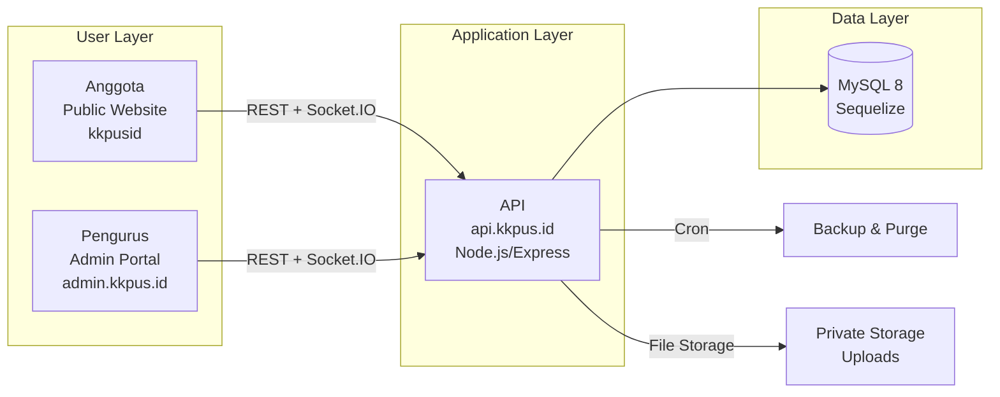

# Technical Specification Document

**Project:** KKPUS Platform  
**Version / status:** 1.0.0 / DRAFT

## 1. Architecture

- **Style:** Modular monolith (3 repos: API, Admin, Public)
- **Context diagram:**

- **Components and responsibilities:**

| Component | Responsibility | Owned data | Interfaces |
| --- | --- | --- | --- |
| API (api.kkpus.id) | Business logic, auth, approval engine, billing, cron, Socket.IO server, file serving | MySQL (all tables) | REST `/api/*`, Socket.IO, `/api/files/*` |
| Admin (admin.kkpus.id) | Pengurus backoffice: dashboard, approvals, members, savings, financing, reports, config | None (consumes API via axios + socket.io-client) | React 18 / Vite 8 SPA |
| Public (kkpusid) | Member portal: landing, registration, dashboard, savings, financing, tabungan, training, billing | None (consumes API via axios + socket.io-client) | React 18 / Vite 8 SPA |
| MySQL 8 | Persistent storage | All tables (members, approvals, bills, transactions, savings, financing, etc.) | TCP 3306 |
| Private file storage | Uploaded KTP/selfie/bukti transfer/dokumen | Binary files (UUID-named) | Served via `/api/files/*` |

## 2. Technology decisions

| Area | Choice | Version | Rationale | Alternatives rejected |
| --- | --- | --- | --- | --- |
| Backend runtime | Node.js | 20+ (LTS) | Fast I/O, large ecosystem, same language as frontend | PHP/Laravel, Python/Django |
| Web framework | Express.js | 5.x | Minimal, flexible, mature middleware ecosystem | NestJS, Fastify |
| ORM | Sequelize | 6.x | Promise-based, migration CLI, model hooks, paranoid soft-delete | TypeORM, Prisma |
| Database | MySQL | 8.x | ACID, JSON support, TDE for encryption at rest | PostgreSQL |
| Real-time | Socket.IO | 4.x | Room support, auto-reconnect, JWT auth middleware | Native WebSocket (more boilerplate) |
| Auth | JWT (jsonwebtoken) | 9.x | Stateless, scalable, works across 3 repos | Session cookies (sticky sessions) |
| Password hashing | bcrypt | 6.x | Industry standard, adaptive cost | Argon2 (not in current stack) |
| Rate limiting | express-rate-limit | 8.x | IP-based, simple, Redis-backable | Custom |
| File upload | multer | 2.x | Memory/disk storage, file size limit | busboy |
| Excel import/export | exceljs | 4.x | Streaming, styling, formula support | xlsx (lighter but less format control) |
| Money math | decimal.js | 10.x | Arbitrary precision, no float errors | Native Number (float precision loss) |
| Frontend (admin) | React + Vite | 18.x / 8.x | Fast HMR, component model, PWA plugin | Vue, Angular |
| Frontend (public) | React + Vite | 18.x / 8.x | Same as admin, code sharing potential | Next.js (SSR not needed) |
| UI library | React-Bootstrap | 2.10.x | Bootstrap 5 components for React | Material-UI, Tailwind |
| State management (public) | XState + React Context | 5.x / built-in | Finite state machines for complex flows | Redux (overkill for this scale) |
| HTTP client | Axios | 1.x | Interceptors for auth, error handling | Fetch (less ergonomic) |
| Real-time client | socket.io-client | 4.x | Auto-reconnect, room join | Native WebSocket |
| Sanitization | DOMPurify | 3.x | XSS prevention for user-generated HTML | Manual regex |
| Web push | web-push (VAPID) | 3.x | Standard Web Push API | Firebase Cloud Messaging (vendor lock) |
| Cron | node-cron | 4.x | Simple cron expressions | node-schedule |
| Process manager | PM2 | 5.x (ecosystem.config.cjs) | Cluster mode, auto-restart, log management | systemd, Docker |
| Testing (backend) | Jest + Supertest | 29.x / 7.x | API contract testing, coverage | Mocha/Chai |
| Testing (frontend) | Vitest + React Testing Library | 4.x / 16.x | Vite-native, component testing | Jest (ESM issues) |

## 3. Module boundaries

| Module | Owns | Depends on | Public interface | Forbidden responsibility |
| --- | --- | --- | --- | --- |
| M-AUTH | JWT issuance/verification, lockout, OTP, token revocation | accounts, login_attempts, account_lockouts, passwordResetToken | `/api/auth/*`, middleware `MidAnggota` | Business rules beyond authentication |
| M-MEMBER | Member CRUD, registration, termination, archive/restore, role assignment | members, member_registrations, membership_terminations, member_role_assignments | `/api/anggota/*` | Approval logic (delegates to M-APPROVAL) |
| M-APPROVAL | Approval engine: flow, steps, maker-checker, final actions | approvals, approval_flows, approval_steps, EntityStepApproval | `/api/approvals/*`, `processApproval()` | Entity-specific business rules (delegates to handlers) |
| M-SAVINGS | Simpanan pokok/wajib/sukarela: products, accounts, transactions, withdrawals | savings_products, member_savings_accounts, savings_transactions, savings_withdrawals | `/api/simpanan/*`, `/api/savings/*` | Payment gateway integration |
| M-BILLING | Bills, invoices, payment verification, fee configs, cooperative banks | bills, bill_items, transactions, payment_fee_configs, cooperative_bank_accounts | `/api/billing/*` | Disbursement execution |
| M-FINANCING | Jual beli, pinjaman lunak, sukuk, pendanaan syariah | jual_beli, member_loans, sukuk_issues, sukuk_orders, financing_applications | `/api/jualbeli/*`, `/api/program/*`, `/api/financing/*` | Approval logic (delegates to M-APPROVAL) |
| M-ARISAN | Arisan batches, participants, draws, payments | arisan_batches, arisan_participants, arisan_draws, arisan_payments | `/api/program/arisan/*` | Approval logic (delegates to M-APPROVAL) |
| M-TABUNGAN | Tabungan bertarget: programs, accounts, transactions, withdrawals | saving_targets, member_saving_targets, savings_transactions | `/api/tabungan/*` | Approval logic (delegates to M-APPROVAL) |
| M-TRAINING | Curriculums, materials, evaluations, rankings | curriculums, materials, material_notes, evaluations, rankings | `/api/training/*` | — |
| M-DASHBOARD | Dashboard aggregation, pending items, statistics | (read-only across all modules) | `/api/dashboard/*`, `/api/financial/*` | Write operations |
| M-NOTIFICATION | Notifications, push subscriptions | notifications, pushSubscription | `/api/notifikasi/*`, `/api/push/*`, Socket.IO | — |
| M-CONTENT | Landing page content, articles, contact forms | landing_*, articles, contact_forms | `/api/landing/*`, `/api/content/*` | — |
| M-CONFIG | Akad, nominal simpanan, fee configs, regions | feature_configs, payment_fee_configs, regions | `/api/simpanan/config`, `/api/billing/fee-config` | — |
| M-CRON | Backup, purge, sync jobs | (scheduled tasks) | services/cron.js | — |
| M-FILES | Authorized file download, path traversal guard | (file system) | `/api/files/*` | File upload (multer handles) |

## 4. Key flows and failure handling

### Flow A — Member registration + approval

1. Calon anggota submit registrasi (8-step form) → `POST /api/anggota/registration` → `member_registrations` (PENDING)
2. Approval flow dibuat: `approval_flows` + `approval_steps` (3 step: Pengawas → Ketua → Bendahara)
3. Pengawas approve step 1 → `processApproval()` → step 2 aktif → Socket.IO `APPROVAL_UPDATE` ke calon anggota
4. Ketua approve step 2 → step 3 aktif
5. Bendahara approve step 3 → `performFinalAction()` → member record dibuat + tagihan awal (pokok + wajib×12) di-generate
6. Jika reject di step manapun → status REJECTED, notifikasi ke calon anggota

**Consistency model:** ACID (single DB transaction per step)  
**Idempotency key:** Not applicable (each approval step is a discrete event)  
**Retries, timeouts, and compensation:** Socket.IO event failure → fallback to HTTP polling; DB transaction rollback on any step failure.  
**Observability:** `activity_logs` (actor, IP, before/after), morgan HTTP logs, error logging.

### Flow B — Manual payment (billing)

1. Anggota transfer ke rekening koperasi + upload bukti → `POST /api/billing/:id/proof` → `transactions` (PENDING_VERIFICATION)
2. Bendahara verifikasi → `PUT /api/billing/:id/verify` → bill status LUNAS, saldo/ledger update
3. Jika bukti tidak valid → REJECTED, anggota upload ulang
4. Cron job cek jatuh tempo → status OVERDUE → notifikasi

**Consistency model:** ACID (transaction + bill update atomically)  
**Idempotency key:** `transaction_id` (proof upload) prevents duplicate verification  
**Retries, timeouts, and compensation:** Payment proof upload timeout 30s → client retry. Disbursement failure → manual intervention by Bendahara.  
**Observability:** `activity_logs`, `transactions` audit trail, morgan logs.

### Flow C — Financing application (jual beli / pinjaman / sukuk / pendanaan)

1. Anggota submit pengajuan → `POST /api/{financing|jualbeli|program|financing}/apply` → record PENDING
2. Approval 3-step (F-03) → APPROVED → DP bill + jadwal angsuran di-generate
3. Anggota bayar angsuran → upload bukti → verifikasi → saldo/piutang update
4. Laporan jurnal ter-update via `ledgerHelper` (decimal.js)

**Consistency model:** ACID (approval + bill generation atomically)  
**Idempotency key:** `financing_application_id` / `jual_beli_id`  
**Retries, timeouts, and compensation:** Payment timeout → retry. Ledger sync failure → retry with backoff.  
**Observability:** `activity_logs`, sync service logs (`savingsReportSyncService`, `jualBeliReportSyncService`, `financialSummarySyncService`).

### Flow D — Real-time notifications

1. Server event triggered (approval update, registration update, transaction update)
2. `notificationService` creates `notifications` DB record + emits Socket.IO event to user's room
3. Client receives event → updates UI (bell icon, toast)
4. If user offline → push notification via VAPID

**Consistency model:** Eventual (DB write first, then Socket.IO emit best-effort)  
**Idempotency key:** `notification_id`  
**Retries, timeouts, and compensation:** Socket.IO failure → DB notification still persisted; client polls on reconnect.  
**Observability:** Socket.IO connection logs, notification delivery logs.

## 5. Security and operations

- **Authentication / authorization:** JWT Bearer token (header + `auth_token` cookie), `MidAnggota` middleware verifies token, `MidRole` middleware checks role against `MemberRoleAssignment`. Token revocation via denylist (`tokenRevocationService`).
- **Secret handling:** `.env` per environment (never committed, `.gitignore` enforced, `.gitleaks.toml` for secret scanning in CI). JWT secret, DB credentials, VAPID keys all from env.
- **Data classification / encryption:**
  - Confidential: NIK, KTP/selfie images, bank account details, phone, email → masked in UI (ISO 27001 A.8.10), encrypted at rest (MySQL TDE).
  - Internal: member financial summary, transaction history → access-controlled by role.
  - Public: landing page content, published articles → no auth required.
- **Rate limits / abuse controls:** `express-rate-limit` on all routes; stricter limits on login (5/min), OTP (3/min), password-reset (3/min). IP-based + user-based dual limiting.
- **File upload security:** multer (5MB limit), magic-byte validation (not just extension), UUID filenames, private storage root (not web-accessible), authorized download via `/api/files/*` with path traversal guard.
- **Environments / configuration:** `local`, `dev`, `staging`, `production`. Config via env vars validated at startup (`dotenv`). Fail-fast on missing/invalid config.
- **Deployment / rollback:** PM2 cluster mode (`ecosystem.config.cjs`), zero-downtime reload. Rollback: `git revert` + `pm2 reload`. Rollback must complete within 15 minutes (14_GLOBAL_STANDARDS §6).
- **Backup / recovery objectives:** Monthly DB backup (cron, 1st of month 00:00). Daily identity doc purge at 02:00 (if `RETENTION_AUTOPURGE=true`). RPO: 24h (daily backup). RTO: 4h.
- **Security headers:** Helmet.js (CSP, HSTS, X-Frame-Options, X-Content-Type-Options, Referrer-Policy).
- **CORS:** Configured per origin (admin.kkpus.id, kkpusid domains).

## 6. Non-functional requirements

| Category | Requirement | Measurement | Target |
| --- | --- | --- | --- |
| Performance — API | p95 response time | APM / manual load test | < 300ms (read), < 500ms (write) |
| Performance — Frontend | LCP (Largest Contentful Paint) | Lighthouse CI | < 2.5s |
| Performance — Bundle | Initial JS bundle (admin) | `vite build` output | < 500KB gzipped |
| Availability — API | Uptime | Uptime monitoring (Pingdom/UpTimeRobot) | 99.5% |
| Availability — Frontend | Uptime (PWA offline) | Service worker + cache | App shell offline-capable |
| Scalability — DB | Connection pool | Sequelize pool config | max 20 connections, min 5 |
| Scalability — Socket.IO | Concurrent connections | PM2 cluster mode | 1000+ concurrent |
| Security — Auth | MFA for privileged accounts | Manual check | Pengawas/Ketua/Bendahara use MFA (future) |
| Security — Dependencies | SCA scan | `npm audit --audit-level=high` | 0 high/critical CVEs |
| Security — Secrets | Secret scan | gitleaks in CI | 0 secrets committed |
| Accessibility | WCAG 2.2 AA | axe-core + manual audit | All user-facing UI meets AA |
| Accessibility — Keyboard | Full keyboard operability | Manual test | All interactive elements keyboard accessible |
| Accessibility — Contrast | Colour contrast | axe-core | ≥ 4.5:1 (text), ≥ 3:1 (UI/large) |
| i18n | Externalised strings | Code review | No hardcoded Indonesian strings in components (future: i18n framework) |
| Observability — Logging | Structured JSON with correlation ID | morgan + custom logger | All requests logged with request ID |
| Observability — Metrics | RED (rate, errors, duration) | Custom metrics or Prometheus | Per-endpoint metrics |
| Observability — Tracing | Distributed trace ID | Correlation ID in headers | Cross-service trace (API → DB) |
| Testing — Coverage | Line coverage for new code | Jest `--coverage` / Vitest `--coverage` | ≥ 70% for new code |
| Testing — E2E | Critical journeys | Supertest (API) / Playwright (admin) | All P0 flows covered |
| Data integrity | Decimal precision for money | `decimal.js` usage | No float arithmetic for financial calculations |
| Data retention | Identity doc purge | Cron + `RETENTION_AUTOPURGE` | Configurable per doc type |
| Browser support | Modern browsers | Browserslist config | Last 2 versions Chrome, Firefox, Safari, Edge |

## 7. Deployment topology

| Environment | API | Admin | Public | Database |
| --- | --- | --- | --- | --- |
| local | `npm run dev` (nodemon, port 3000) | `npm run dev` (Vite, port 5173) | `npm run dev` (Vite, port 3000) | Local MySQL 8 |
| dev | PM2 cluster, port 3000 | Static build (nginx) | Static build (nginx) | Shared dev MySQL |
| staging | PM2 cluster | Static build | Static build | Staging MySQL |
| production | PM2 cluster (behind reverse proxy) | CDN (Vite PWA) | CDN (Vite PWA) | Production MySQL (TDE) |

**Reverse proxy:** Nginx (SSL termination, rate limiting, static file serving for frontend builds).  
**CI/CD:** GitHub Actions (lint → test → build → deploy to staging on merge to `main`; production via tagged release with manual approval).