# Database Schema / ERD

**Project:** KKPUS Platform  
**Database:** MySQL 8  
**Last reviewed:** 2026-11-21

## 1. Data model overview

Skema mencakup 5 domain utama: **Core & Auth**, **Approvals**, **Billing & Payments**, **Savings & Financing**, dan **Content & Training**. Semua PK berbasis UUID (UUIDV4) kecuali tabel referensi/lookup. Kolom uang menggunakan `DECIMAL(18,2)` (presisi, tidak pakai float). Timestamps `created_at`/`updated_at` di semua tabel (kecuali lookup statis). Soft-delete (paranoid) pada `members`.

```mermaid
erDiagram
  MEMBERS ||--o{ MEMBER_ROLE_ASSIGNMENTS : has
  MEMBERS ||--o{ ACCOUNTS : owns
  MEMBERS ||--o{ MEMBER_REGISTRATIONS : submits
  MEMBERS ||--o{ MEMBERSHIP_TERMINATIONS : requests
  MEMBERS ||--o{ MEMBER_EMPLOYMENTS : has
  MEMBERS ||--o{ MEMBER_EMERGENCY_CONTACTS : has
  MEMBERS ||--o{ MEMBER_BANK_ACCOUNTS : has
  MEMBERS ||--o| MEMBER_FINANCIAL_SUMMARY : summarized_by
  MEMBER_STATUS ||--o{ MEMBERS : classifies
  USER_ROLES ||--o{ MEMBER_ROLE_ASSIGNMENTS : assigned_as

  APPROVAL_FLOWS ||--o{ APPROVAL_STEPS : contains
  APPROVAL_STEPS ||--o{ ENTITY_STEP_APPROVAL : records
  APPROVAL_STATUSES ||--o{ APPROVALS : statuses

  BILLS ||--o{ BILL_ITEMS : line_items
  BILL_TYPES ||--o{ BILLS : categorizes
  BILLS ||--o{ TRANSACTIONS : paid_by
  COOPERATIVE_BANK_ACCOUNTS ||--o{ TRANSACTIONS : receives

  SAVINGS_PRODUCTS ||--o{ MEMBER_SAVINGS_ACCOUNTS : product_of
  MEMBER_SAVINGS_ACCOUNTS ||--o{ SAVINGS_TRANSACTIONS : transacts
  SAVINGS_WITHDRAWALS ||--o{ SAVINGS_TRANSACTIONS : produces

  SAVING_TARGETS ||--o{ MEMBER_SAVING_TARGETS : target_of
  MEMBER_SAVING_TARGETS ||--o{ SAVINGS_TRANSACTIONS : transacts

  FINANCING_CATEGORIES ||--o{ FINANCING_APPLICATIONS : categorizes
  FINANCING_APPLICATIONS ||--o{ FINANCING_TERMS : terms
  SUKUK_ISSUES ||--o{ SUKUK_ORDERS : issue_of

  ARISAN_BATCHES ||--o{ ARISAN_PARTICIPANTS : includes
  ARISAN_BATCHES ||--o{ ARISAN_DRAWS : draws
  ARISAN_PARTICIPANTS ||--o{ ARISAN_PAYMENTS : pays

  CURRICULUMS ||--o{ MATERIALS : contains
  MATERIALS ||--o{ MATERIAL_NOTES : annotated_by
  CURRICULUMS ||--o{ EVALUATIONS : evaluates
  EVALUATIONS ||--o{ RANKINGS : produces
```

## 2. Entities

### Domain: Core & Auth

#### members
**Purpose:** Master data anggota koperasi (paranoid soft-delete). 
**Relations:** `member_status` (N:1), `accounts` (1:N), `member_role_assignments` (1:N), `member_registrations` (1:N), `membership_terminations` (1:N), `member_employments`/`member_emergency_contacts`/`member_bank_accounts` (1:N), `member_financial_summary` (1:1).

| Column | Type | Null | Default | Constraints / index | Description |
| --- | --- | --- | --- | --- | --- |
| member_id | CHAR(36) | no | UUIDV4 | PK | Identitas anggota |
| member_no | VARCHAR(20) | no | — | UNIQUE | Nomor anggota |
| full_name | VARCHAR(255) | no | — | — | Nama lengkap |
| email | VARCHAR(255) | yes | — | — | Email |
| phone_number | VARCHAR(50) | yes | — | — | No. HP |
| password_hash | VARCHAR(255) | yes | — | — | bcrypt hash |
| member_type | VARCHAR(20) | yes | — | — | Reguler / Luar Biasa |
| gender | VARCHAR(20) | yes | — | — | Jenis kelamin |
| date_of_brith | DATE | yes | — | — | Tanggal lahir (typo di kode: date_of_brith) |
| join_date | DATE | yes | — | — | Tanggal gabung |
| nik_ktp | VARCHAR(50) | yes | — | — | NIK (masking di UI) |
| address | TEXT | yes | — | — | Alamat |
| status_id | CHAR(36) | yes | — | FK → member_status | Status keanggotaan |
| is_registration_done | TINYINT(1) | yes | 0 | — | Registrasi selesai |
| province_id/city_id/district_id/subdistrict_id | CHAR(36) | yes | — | — | Alamat granular (Wilayah) |
| rt / rw | VARCHAR(5) | yes | — | — | RT/RW |
| created_at / updated_at | TIMESTAMP | yes | — | — | Audit timestamps |
| deleted_at | TIMESTAMP | yes | NULL | paranoid | Soft-delete |

**Authorization boundary:** Anggota baca tulis milik sendiri; pengurus baca semua (masking NIK); role assignment oleh pengurus berwenang.

#### member_status
**Purpose:** Lookup status keanggotaan (Aktif, Nonaktif, Calon, dll).  
**Relations:** `members` (1:N). Kolom: `status_id` (PK), `status_name` (VARCHAR), `description`. **Lifecycle:** reference data.

#### user_roles
**Purpose:** Lookup peran organisasi (Pengawas, Ketua, Bendahara).  
**Relations:** `member_role_assignments` (1:N). Kolom: `role_id` (PK), `role_name` (VARCHAR unique). **Lifecycle:** reference data.

#### member_role_assignments
**Purpose:** Penetapan peran pengurus ke anggota (dengan masa berlaku).  
**Relations:** `members` (N:1), `user_roles` (N:1).

| Column | Type | Null | Default | Constraints | Description |
| --- | --- | --- | --- | --- | --- |
| id | CHAR(36) | no | UUIDV4 | PK | — |
| member_id | CHAR(36) | no | — | FK → members | Anggota |
| role_id | CHAR(36) | no | — | FK → user_roles | Peran |
| start_date | DATE | no | — | — | Mulai berlaku |
| end_date | DATE | yes | NULL | — | Berakhir (NULL = aktif) |
| is_active | TINYINT(1) | yes | 1 | — | Status aktif |

**Authorization boundary:** Hanya anggota tipe Reguler dapat di-assign (BR-02.03).

#### member_registrations
**Purpose:** Pengajuan registrasi anggota baru (pending approval).  
**Relations:** `members` (N:1 opsional, di-set setelah approved). Kolom kunci: `registration_id` (PK), `member_id` (FK nullable), `registration_data` (JSON), `status`, `created_at`. 

#### membership_terminations
**Purpose:** Pengajuan terminasi/pengunduran diri. Kolom: `termination_id` (PK), `member_id` (FK), `reason` (TEXT), `status`, `financial_summary_snapshot` (JSON).

#### member_employments / member_emergency_contacts / member_bank_accounts
**Purpose:** Data pendukung anggota. 
- `member_employments`: `employment_id` (PK), `member_id` (FK), `company_name`, `position`, `employment_type`, `monthly_income` (DECIMAL).
- `member_emergency_contacts`: `contact_id` (PK), `member_id` (FK), `name`, `relationship`, `phone_number`.
- `member_bank_accounts`: `bank_account_id` (PK), `member_id` (FK), `bank_name`, `account_number`, `account_holder`.
**Authorization boundary:** Confidential; masking di UI.

#### member_financial_summary
**Purpose:** Ringkasan finansial anggota (denormalized, di-sync via hook). Kolom: `member_id` (PK, FK), `total_savings` (DECIMAL), `total_financing` (DECIMAL), `total_piutang` (DECIMAL), `updated_at`. **Lifecycle:** dihitung ulang oleh `financialSummarySyncService`.

#### accounts
**Purpose:** Rekening simpanan anggota (pokok/wajib/sukarela). Kolom: `account_id` (PK), `member_id` (FK), `account_type` (VARCHAR), `account_no`, `open_date` (DATE), `akad_type` (VARCHAR), `current_balance` (DECIMAL(18,2) default 0). Hook `afterSave`/`afterDestroy` → sync summary.

#### account_lockouts
**Purpose:** Lockout login sementara. Kolom: `id` (PK), `account_identifier` (VARCHAR), `locked_until` (DATETIME), `reason`.

#### login_attempts
**Purpose:** Audit percobaan login. Kolom: `id` (PK), `account_identifier`, `ip_address`, `success` (TINYINT), `created_at`.

#### feature_configs
**Purpose:** Konfigurasi produk (nominal simpanan, akad, dll.) dengan tanggal efektif. Kolom: `config_id` (PK), `feature_key` (VARCHAR), `config_value` (JSON), `effective_date` (DATE), `description`.

### Domain: Approvals

#### approval_flows
**Purpose:** Definisi flow approval per jenis entitas. Kolom: `flow_id` (PK), `entity_type` (VARCHAR), `flow_name`, `is_active`.

#### approval_steps
**Purpose:** Urutan langkah dalam flow. Kolom: `step_id` (PK), `flow_id` (FK), `step_order` (INT), `role_name` (VARCHAR — Pengawas/Ketua/Bendahara), `is_final` (TINYINT).

#### approval_statuses
**Purpose:** Lookup status approval (PENDING/APPROVED/REJECTED). Kolom: `status_id` (PK), `status_name`.

#### approvals
**Purpose:** Instance approval untuk entitas tertentu. Kolom: `approval_id` (PK), `entity_type` (VARCHAR), `entity_id` (CHAR36), `flow_id` (FK), `current_step_id` (FK → approval_steps, NULL jika final), `status_id` (FK → approval_statuses), `created_by` (member_id), `created_at`, `finalized_at`.

#### EntityStepApproval
**Purpose:** Mencegah approver yang sama menyetujui >1 step (BR-03.05). Kolom: `id` (PK), `approval_id` (FK), `step_id` (FK), `approver_id` (member_id), `decision`, `note`, `decided_at`. **Unique index:** `(approval_id, step_id)` dan `(approval_id, approver_id)`.

### Domain: Billing & Payments

#### bill_types
**Purpose:** Lookup jenis tagihan (SW_POKOK, SW_WAJIB, DP, ANGSURAN, TABUNGAN, VOLUNTARY). Kolom: `bill_type_id` (PK), `type_code` (unique), `type_name`, `description`.

#### bills
**Purpose:** Tagihan ke anggota. Kolom: `bill_id` (PK), `member_id` (FK), `bill_type_id` (FK), `amount` (DECIMAL), `description`, `due_date` (DATE), `status` (PENDING/PENDING_VERIFICATION/LUNAS/OVERDUE), `created_at`.

#### bill_items
**Purpose:** Rincian item dalam bill (mis. pokok + wajib×12). Kolom: `bill_item_id` (PK), `bill_id` (FK), `item_description`, `amount` (DECIMAL), `quantity`, `sort_order`.

#### transactions
**Purpose:** Pembayaran/transfer (pembayaran bill, setoran, pencairan). Kolom: `transaction_id` (PK), `bill_id` (FK nullable), `member_id` (FK), `amount` (DECIMAL), `type` (PEMBAYARAN/SETORAN/PENCAIRAN/DISBURSEMENT), `payment_method` (TRANSFER), `bank_account_id` (FK → cooperative_bank_accounts), `proof_file_path` (VARCHAR), `status` (PENDING_VERIFICATION/VERIFIED/REJECTED), `verified_by` (member_id), `verified_at`, `payment_reference` (VARCHAR(100), NOT NULL UNIQUE — referensi pembayaran internal format `BILL-*`/`MANUAL-*`/`SBP-*`/`WD-*`), `external_transaction_id` (VARCHAR(100), nullable), `created_at`.

#### payment_fee_configs
**Purpose:** Biaya admin per metode. Kolom: `fee_id` (PK), `payment_method` (VARCHAR), `fee_type` (FLAT/PERCENTAGE), `fee_value` (DECIMAL), `is_active`.

#### cooperative_bank_accounts
**Purpose:** Rekening tujuan transfer koperasi. Kolom: `bank_account_id` (PK), `bank_name`, `account_number`, `account_holder`, `is_active`.

### Domain: Savings

#### savings_products
**Purpose:** Produk simpanan (Pokok/Wajib/Sukarela). Kolom: `product_id` (PK), `product_name`, `product_type`, `akad_type`, `description`, `is_active`.

#### member_savings_accounts
**Purpose:** Rekening simpanan anggota per produk. Kolom: `savings_account_id` (PK), `member_id` (FK), `product_id` (FK), `balance` (DECIMAL), `opened_at`.

#### savings_transactions
**Purpose:** Mutasi simpanan (setoran/pencairan). Kolom: `savings_transaction_id` (PK), `savings_account_id` (FK), `transaction_id` (FK nullable), `type` (SETORAN/PENCAIRAN), `amount` (DECIMAL), `balance_after` (DECIMAL), `created_at`.

#### savings_withdrawals
**Purpose:** Pengajuan penarikan simpanan (pending approval). Kolom: `withdrawal_id` (PK), `member_id` (FK), `savings_account_id` (FK), `amount` (DECIMAL), `reason`, `approval_id` (FK), `status`, `disbursement_proof_path`, `created_at`.

#### saving_targets / member_saving_targets
**Purpose:** Master program tabungan bertarget + progres per anggota. 
- `saving_targets`: `target_id` (PK), `program_name`, `target_amount` (DECIMAL), `category`, `year`.
- `member_saving_targets`: `member_target_id` (PK), `member_id` (FK), `target_id` (FK), `saved_amount` (DECIMAL), `progress`.

#### savings_report / savings_report_list / savings_journal_report
**Purpose:** Tabel agregasi laporan (di-sync oleh `savingsReportSyncService`). List report & jurnal (debit/kredit) per periode.

#### midtrans_disbursements
**Purpose:** Legacy — model Sequelize dihapus (BLK-006, 2026-11-22); tabel lama berpotensi masih ada di DB (kandidat drop pada migrasi berikutnya). Kolom: `id` (PK), `reference`, `amount`, `status`.

### Domain: Financing & Programs

#### financing_categories
**Purpose:** Kategori pembiayaan (jual beli, mudharabah, musyarakah, dst). Kolom: `category_id` (PK), `category_name`, `akad_type`, `description`.

#### financing_applications
**Purpose:** Pengajuan pembiayaan/pendanaan syariah. Kolom: `application_id` (PK), `member_id` (FK), `category_id` (FK), `amount` (DECIMAL), `tenor_months` (INT), `purpose`, `approval_id` (FK), `status`, `created_at`.

#### financing_terms
**Purpose:** Term & jadwal angsuran per aplikasi. Kolom: `term_id` (PK), `application_id` (FK), `installment_no` (INT), `due_date` (DATE), `amount` (DECIMAL), `status`.

#### business_profiles
**Purpose:** Profil usaha anggota (untuk pembiayaan). Kolom: `business_profile_id` (PK), `member_id` (FK), `business_name`, `business_type`, `monthly_revenue` (DECIMAL), `years_operating`.

#### sukuk_issues
**Purpose:** Penerbitan sukuk. Kolom: `issue_id` (PK), `issue_name`, `total_quota` (DECIMAL), `offering_price` (DECIMAL), `return_rate` (DECIMAL), `start_date`, `end_date`, `status` (OPEN/CLOSED).

#### sukuk_orders
**Purpose:** Order investasi sukuk. Kolom: `order_id` (PK), `issue_id` (FK), `member_id` (FK), `amount` (DECIMAL), `approval_id` (FK), `status`, `created_at`.

#### jual_beli / jual_beli_report
**Purpose:** Transaksi jual beli (murabahah) + laporan agregat. Kolom `jual_beli`: `id` (PK), `member_id` (FK), `barang` (VARCHAR), `harga_pokok` (DECIMAL), `harga_jual` (DECIMAL), `dp` (DECIMAL), `tenor_months`, `angsuran` (DECIMAL), `sisa_piutang` (DECIMAL), `status`, `created_at`.

#### loan_products / member_loans
**Purpose:** Produk pinjaman + pinjaman anggota. 
- `loan_products`: `product_id` (PK), `product_name`, `max_amount`, `tenor_options`, `description`.
- `member_loans`: `loan_id` (PK), `member_id` (FK), `product_id` (FK), `amount` (DECIMAL), `tenor_months`, `installment` (DECIMAL), `sisa_piutang` (DECIMAL), `approval_id` (FK), `status`.

#### pinjaman_modal / pinjaman_hutang / pinjaman_aktiva_tetap
**Purpose:** Input modal koperasi & pembukuan pinjaman. 
- `pinjaman_modal`: `id` (PK), `type` (DEBET/KREDIT), `amount` (DECIMAL), `description`, `created_at`.
- `pinjaman_hutang`: utang kas (hutang, amount, due date).
- `pinjaman_aktiva_tetap`: aktiva tetap (nama, nilai, akuisisi).

#### program_options
**Purpose:** Opsi program (tenor, nominal) per produk.

#### arisan_programs
**Purpose:** Master program arisan. Kolom: `program_id` (PK), `program_name`, `description`, `is_active`.

#### arisan_batches
**Purpose:** Batch arisan (kuota, target, angsuran, periode). Kolom: `batch_id` (PK), `program_id` (FK), `quota` (INT), `target_amount` (DECIMAL), `monthly_installment` (DECIMAL), `tenor_months`, `start_date`, `status` (DRAFT/ACTIVE/FULL/COMPLETED).

#### arisan_participants
**Purpose:** Peserta batch. Kolom: `participant_id` (PK), `batch_id` (FK), `member_id` (FK), `status` (JOINED/WON), `joined_at`.

#### arisan_payments
**Purpose:** Pembayaran angsuran arisan. Kolom: `payment_id` (PK), `participant_id` (FK), `period` (VARCHAR), `amount` (DECIMAL), `transaction_id` (FK), `created_at`.

#### arisan_draws
**Purpose:** Hasil kocokan/draw bulanan. Kolom: `draw_id` (PK), `batch_id` (FK), `period` (VARCHAR), `winner_participant_id` (FK), `disbursement_proof_path`, `drawn_at`.

### Domain: Content, Training & Notifications

#### articles
**Purpose:** Artikel edukasi/publikasi. Kolom: `article_id` (PK), `title`, `content` (LONGTEXT, di-sanitize DOMPurify), `author`, `status` (DRAFT/PUBLISHED), `published_at`.

#### notifications
**Purpose:** Notifikasi in-app. Kolom: `notification_id` (PK), `member_id` (FK), `title`, `message`, `category`, `related_entity_type`, `related_entity_id`, `is_read` (TINYINT), `created_at`.

#### activity_logs
**Purpose:** Audit trail aksi sensitif (append-only secara aplikasi). Kolom: `log_id` (PK), `user_id` (FK), `action` (VARCHAR), `entity_type`, `entity_id`, `old_value` (JSON), `new_value` (JSON), `ip_address`, `user_agent`, `created_at`.

#### passwordResetToken
**Purpose:** Token reset password. Kolom: `id` (PK), `member_id` (FK), `token_hash`, `expires_at`, `used_at`.

#### forgotPasswordSession
**Purpose:** Session OTP lupa password. Kolom: `id` (PK), `identifier`, `otp_hash`, `expires_at`, `attempts`, `verified_at`.

#### pushSubscription
**Purpose:** Web push subscription (VAPID). Kolom: `id` (PK), `member_id` (FK), `endpoint`, `p256dh`, `auth`, `created_at`.

#### landing_stats / landing_services / landing_about / landing_contact / contact_forms
**Purpose:** Konten landing page publik. 
- `landing_stats`: label + nilai statistik (angka real-time di-cache).
- `landing_services`: daftar layanan (judul, deskripsi, ikon).
- `landing_about`: teks tentang.
- `landing_contact`: info kontak.
- `contact_forms`: `id` (PK), `name`, `email`, `message`, `created_at`.

#### curriculums / materials / material_notes / evaluations / rankings
**Purpose:** Modul pelatihan. 
- `curriculums`: `curriculum_id` (PK), `title`, `level` (WAJIB/REGULER), `description`.
- `materials`: `material_id` (PK), `curriculum_id` (FK), `title`, `type` (TEXT/VIDEO/DOC), `content_url`, `sequence`.
- `material_notes`: `note_id` (PK), `material_id` (FK), `member_id` (FK), `note` (TEXT).
- `evaluations`: `evaluation_id` (PK), `curriculum_id` (FK), `questions` (JSON — multiple choice + answer key), `total_points`.
- `rankings`: `ranking_id` (PK), `evaluation_id` (FK), `member_id` (FK), `score` (DECIMAL), `rank`.

## 3. Integrity and performance rules

- **Invariants:**
  - `member_no` unik global (BR-02.01).
  - NIK unik ( enforced di registrasi).
  - Setiap `EntityStepApproval` unik per `(approval_id, step_id)` dan `(approval_id, approver_id)` (BR-03.05).
  - `current_balance` & semua kolom uang `DECIMAL(18,2)` — tidak boleh negatif untuk simpanan (BR-04.02).
  - `current_step_id` pada `approvals` NULL saat APPROVED/REJECTED (final).
- **Transactions / locking:**
  - Approval step processing menggunakan `SELECT ... FOR UPDATE` (row lock) — BR-03.06.
  - Verifikasi pembayaran + update saldo dalam satu transaksi DB (atomic).
  - Hook `syncFinancialSummary` berjalan `setImmediate` (async, best-effort).
- **Indexes:**
  - `members`: PK `member_id`, UNIQUE `member_no`, index `status_id`, `email`.
  - `approvals`: index `(entity_type, entity_id)`, `current_step_id`, `status_id`.
  - `EntityStepApproval`: UNIQUE `(approval_id, step_id)`, `(approval_id, approver_id)`.
  - `bills`: index `(member_id, status)`, `due_date`.
  - `transactions`: index `(member_id, status)`, `bill_id`.
  - `savings_transactions`: index `(savings_account_id, created_at)`.
  - `arisan_draws`: UNIQUE `(batch_id, period)`.
- **Soft deletion / retention:**
  - `members` paranoid (deleted_at). Restore = clear deleted_at.
  - Dokumen identitas: retensi per jenis (DEC-002), purge via cron bila `RETENTION_AUTOPURGE=true`.
- **Money / precision / time zone:**
  - Semua nominal `DECIMAL(18,2)`, dihitung dengan `decimal.js` (tidak ada float).
  - Tanggal `DATE` (date-only) untuk join/due/effective; timestamp `TIMESTAMP` untuk audit.
  - Zona waktu: server lokal (WIB, UTC+7) — belum dikonversi eksplisit ke UTC (follow-up).

## 4. Migration log

| Migration | Date | Change | Forward path | Rollback / mitigation | Data impact |
| --- | --- | --- | --- | --- | --- |
| Baseline (existing schema) | 2026-11-21 | Dokumentasi skema aktual dari Sequelize models (90 tabel) | Dokumentasi saja (no schema change) | None | None |
| MIG-001 (planned) | TBD | Double-entry journal tables (chart_of_accounts, journal_entries, journal_lines) — DEC-001 | Migration baru + ERD update | Drop tables | Additive, no existing data |
| MIG-002 (planned) | TBD | `RETENTION_AUTOPURGE` config + retention columns — DEC-002 | Config + add columns | Revert config | Minimal |
| MIG-003 (planned) | TBD | `EntityStepApproval` unique index enforcement (BR-03.05) | Migration add unique index | Drop index | None (data integrity) |

| MIG-003 (planned) | TBD | `EntityStepApproval` unique index enforcement (BR-03.05) | Migration add unique index | Drop index | None (data integrity) |
| MIG-004 (ready — belum dijalankan) | 2026-11-22 | BLK-005: rename kolom legacy Midtrans — `transactions.midtrans_order_id` → `payment_reference`, `transactions.midtrans_transaction_id` → `external_transaction_id`, drop `transactions.midtrans_token` (dead); `savings_withdrawals.midtrans_transaction_id` → `external_transaction_id` | `migrations/20261122-rename-midtrans-columns.js` (sequelize-cli) | `down` kembalikan nama lama + re-add `midtrans_token` | Rename: data & index unik </ernie:think><ernie:tool_call>
<invoke name="edit"><parameter name="newString">> **Catatan:** Migration log ini mendokumentasikan skema aktual (baseline) dan perubahan yang direncanakan (DEC-001 double-entry, DEC-002 retention). MIG-004 disiapkan 2026-11-22 (BLK-005, lihat `10_DEV_LOG.md`) — file migrasi siap dijalankan via `npm run db:migrate` di environment dengan DB valid (kredensial DB lokal dev ditolak, belum tereksekusi); MIG-001..003 masih planned (TBD, diisi saat implementasi).